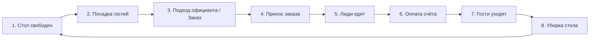
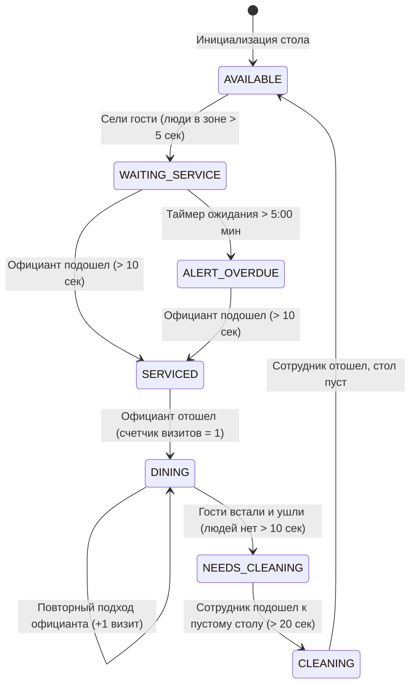

# Чек-лист метрик и функционала видеоаналитики ресторана (без модуля заказов / POS)

Документ определяет архитектурное разделение метрик ресторанного зала на основе схемы жизненного цикла стола в условиях **полного отсутствия кассового модуля (POS / iiko / r_keeper)**. Система опирается исключительно на видеопоток с камер наблюдения и компьютерное зрение (YOLO11 Pose + детекция столов).

---

## 1. Схема жизненного цикла обслуживания

---

## 2. Матрица разделения метрик

| # | Метрика из схемы | Категория | Метод реализации | Требуется ли ручная помощь / POS? | Бизнес-ценность |
|---|---|:---:|---|:---:|:---:|
| **1** | **Посадка гостей** (`T_seated`) | 🟢 **Обязательная** | YOLO-Pose: появление сидящих людей в зоне стульев (>5 сек) | ❌ **Нет (100% Автономно)** | 🔥 Высокая |
| **2** | **Количество гостей за столом** | 🟢 **Обязательная** | YOLO-Pose: подсчет уникальных скелетов в зоне стола | ❌ **Нет (100% Автономно)** | 🔥 Высокая |
| **3** | **Первый подход официанта** (`T_first_approach`) | 🟢 **Обязательная** | Детекция стоящего человека рядом со столом (>10 сек) | ❌ **Нет (100% Автономно)** | 🔥 Критическая |
| **4** | **Контроль SLA ожидания (таймер 5 мин)** | 🟢 **Обязательная** | Обратный таймер: если `T_current - T_seated > 5 мин` без официанта | ❌ **Нет (100% Автономно)** | 🔥 Критическая |
| **5** | **Количество подходов персонала** | 🟢 **Обязательная** | Счетчик эпизодов присутствия стоящего человека у стола | ❌ **Нет (100% Автономно)** | ⚡ Средняя |
| **6** | **Уход гостей** (`T_departure`) | 🟢 **Обязательная** | YOLO-Pose: полное отсутствие людей в полигоне стола | ❌ **Нет (100% Автономно)** | 🔥 Высокая |
| **7** | **Длительность визита** (`Visit Duration`) | 🟢 **Обязательная** | Разница времени: `T_departure - T_seated` | ❌ **Нет (100% Автономно)** | 🔥 Высокая |
| **8** | **Статус «Стол требует уборки»** | 🟢 **Обязательная** | Автопереход стола в статус `Needs Cleaning` сразу после ухода гостей | ❌ **Нет (100% Автономно)** | 🔥 Высокая |
| **9** | **Время уборки и готовность стола** | 🟢 **Обязательная** | Детекция стоящего сотрудника у пустого стола (>30 сек) + освобождение | ❌ **Нет (100% Автономно)** | ⚡ Средняя |
| **10** | **Общая загрузка зала** | 🟢 **Обязательная** | Агрегация занятых столов и числа гостей в реальном времени | ❌ **Нет (100% Автономно)** | 🔥 Высокая |
| **11** | **Принос заказа / первого блюда** | 🟡 *Необязательная* | Эвристика: подход стоящего человека через 8–25 минут после посадки | ⚠️ Частично (эвристика CV) | ⚡ Средняя |
| **12** | **Люди едят (длительность трапезы)** | 🟡 *Необязательная* | Интервал от предполагаемого приноса блюда до ухода | ⚠️ Частично (эвристика CV) | 💡 Информационная |
| **13** | **Забытые вещи на столе** | 🟡 *Необязательная* | Детекция оставшихся мелких объектов после ухода гостей | ⚠️ Требует спец-модели | 💡 Информационная |
| **14** | **Принятие заказа в системе** | 🔴 *Внешняя / Ручная* | Точный момент фиксации заказа | ❗ **Обязательно (POS / клик)** | 🔥 Высокая |
| **15** | **Запрос счёта гостем** | 🔴 *Внешняя / Ручная* | Жест/просьба гостя принести счет | ❗ **Обязательно (POS / клик)** | ⚡ Средняя |
| **16** | **Оплата счёта** | 🔴 *Внешняя / Ручная* | Пробитие чека / безналичная транзакция | ❗ **Обязательно (POS / касса)** | 🔥 Высокая |

---

## 3. Детальный разбор категорий

### 🟢 Категория 1. Обязательные базовые метрики (100% Computer Vision)
*Не требуют интеграции с POS, кнопок официантов или ручного ввода.*

1. **Детекция посадки и ухода гостей**:
   - Определение изменения состояния стола с `Свободен` на `Занят` с гистерезисом 5 секунд (защита от случайных прохожих).
   - Точный хронометраж каждого визита.
2. **Время ожидания первого контакта (SLA 5 минут)**:
   - В момент посадки запускается таймер ожидания.
   - Если за 5 минут ни один стоящий сотрудник не подошел к столу на время более 10 секунд — срабатывает визуальный алерт: **«Стол ожидает обслуживания!»**.
   - Фиксируется время реакции персонала: `Время ожидания = T_подхода - T_посадки`.
3. **Подсчет гостей**:
   - Точное количество персон за каждым столом на основе скелетных ключевых точек.
   - Расчет коэффициента использования вместимости стола (например, 2 человека за 4-местным столом = 50%).
4. **Контроль чистоты и оборачиваемости (Turnaround)**:
   - Как только гости встали и вышли из зоны стола, стол автоматически переходит в статус `Требует уборки (Needs Cleaning)`.
   - Включается таймер простоя грязного стола.
   - Подход уборщика/официанта на 20–60 секунд без гостей сбрасывает статус в `Готов к посадке (Available)`.

---

### 🟡 Категория 2. Необязательные / Эвристические метрики (CV с допущениями)
*Могут быть реализованы на чистом видеоряде, но имеют вероятностный характер.*

1. **Принос первого блюда**:
   - *Подход*: По видео с потолочной камеры тарелки часто перекрываются спинами людей. Поэтому используется поведенческая эвристика: подход стоящего человека в интервале от 8 до 25 минут после посадки классифицируется как «Подача заказа».
2. **Длительность нахождения на посту / перекуры персонала**:
   - Разметка служебных зон (зона за барной стойкой, стойка хостес, курилка, зона отдыха).
   - Подсчет времени присутствия/отсутствия сотрудника в его рабочей зоне.
3. **Фиксация забытых вещей**:
   - После ухода людей модель анализирует оставшиеся замкнутые контуры на столешнице (сумки, телефоны, папки).

---

### 🔴 Категория 3. Метрики с обязательной ручной помощью или POS-интеграцией
*Без данных с кассового терминала или действий персонала автоматизировать через камеру невозможно.*

1. **Принятие заказа**:
   - Камера не видит текст на планшете/блокноте официанта. Официант может подойти просто налить воды или поздороваться, а заказ принять позже.
   - *Альтернатива*: Ручной клик официанта в мобильном приложении либо интеграция с вебхуком POS-системы.
2. **Оплата счёта и сумма чека**:
   - Оплата телефоном/картой через терминал с точки зрения видеокамеры неотличима от обычного использования смартфона гостем.
   - *Альтернатива*: Интеграция с кассой по номеру стола (привязка времени закрытия чека в кассе к сессии посадки из видеоаналитики).

---

## 4. Конечный автомат стола для реализации в Video Analytics

В сервисе Python [analytics/](file:///E:/Projects/FoodVision/analytics) рекомендуется реализовать следующий конечный автомат (State Machine):

---

## 5. Чек-лист реализации функционала (Roadmap)

### Этап 1. Базовая аналитика обслуживания (CV Only, Без POS)
- [ ] **1.1. Детектор позы официанта / стоящего человека**:
  - Распознавание стоящей вертикальной позы у стола на основе ключевых точек (Keypoints: плечи, таз, колени).
  - Фильтрация случайных прохожих (порог времени присутствия в зоне стульев $\ge 10$ секунд).
- [ ] **1.2. Расширение состояний стола в Python Analytics**:
  - Добавление статусов: `AVAILABLE`, `WAITING_SERVICE`, `ALERT_OVERDUE`, `SERVICED`, `DINING`, `NEEDS_CLEANING`, `CLEANING`.
  - Таймер от момента посадки до первого подхода.
  - Счетчик количества подходов официанта за сессию визита.
- [ ] **1.3. Таймер SLA и тревожные оповещения**:
  - Настраиваемый порог времени ожидания (по умолчанию: 5 минут).
  - Генерация события алерта при превышении порога в реальном времени.
- [ ] **1.4. Журнал сессий посадок в PostgreSQL**:
  - Запись в базу: `table_id`, `seated_at`, `first_contact_at`, `left_at`, `staff_visits_count`, `guests_count`, `cleaning_duration_seconds`.
- [ ] **1.5. Отображение в UI (React)**:
  - Бейджи статусов столов в `RestaurantStatusPanel`:
    - 🟢 `Свободен`
    - 🟡 `Ожидает официанта (03:14)`
    - 🔴 `Задержка обслуживания (> 5 мин)`
    - 🔵 `Обслуживается (подходов: 3)`
    - 🟠 `Требует уборки`

### Этап 2. Аналитика персонала и зон (Продвинутый CV)
- [ ] **2.1. Зонирование зала для персонала**:
  - Разметка рабочих постов (стойка хостес, бар, зона выдачи блюд).
  - Разметка зоны отдыха / перекуров.
- [ ] **2.2. Расчет времени присутствия на посту**:
  - Время на посту vs время в зале vs время в зоне отдыха.

### Этап 3. Гибридная интеграция с кассой (Опционально / На перспективу)
- [ ] **3.1. REST API / Webhook для POS-систем**:
  - Эндпоинты `POST /api/pos/order_opened`, `POST /api/pos/order_paid`.
  - Автоматическая склейка сессии из видеоаналитики с чеком из кассы по номеру стола.
